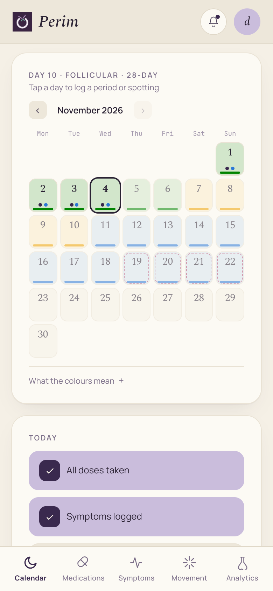
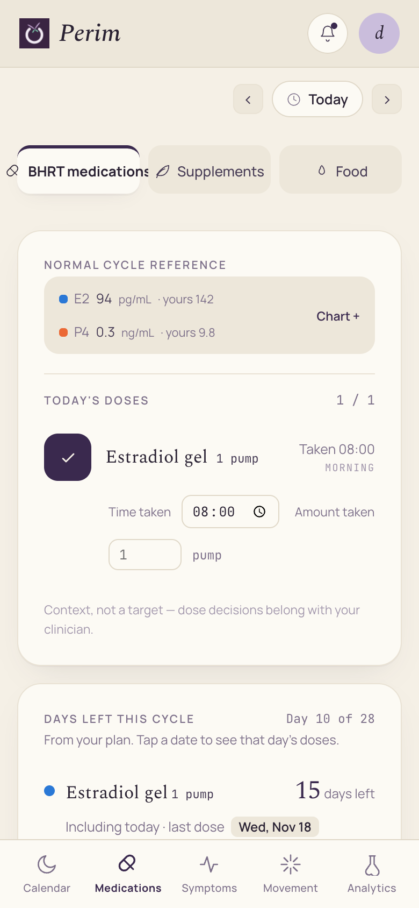
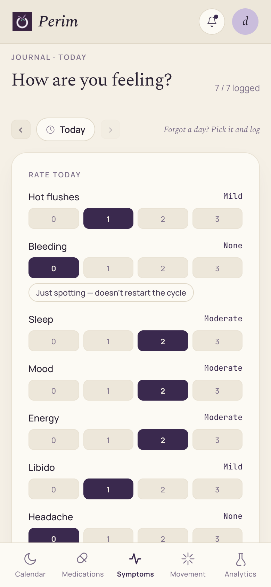

# Perim

A private, phone-first tracker for women in perimenopause who use cyclic bioidentical hormone therapy (BHRT). It keeps the cycle, the medication plan, symptoms and lab results in one place, and turns them into a summary to take to the doctor.

**Live:** https://perim-app.vercel.app (Turkish / English). The app installs to the phone's home screen from the browser.

<!-- Screenshot: home calendar (phone width) → docs/screenshots/calendar.png -->

---

## The problem

In perimenopause, cycles become irregular, symptoms come and go, and cyclic hormone plans are easy to lose track of. A typical plan looks like this: estrogen on days 1–24, progesterone on part of those days, then a few days off. Bleeding usually follows the estrogen break, and sometimes it does not come at all.

Without a dedicated tool, this information is spread across several places:
- notes for the doses,
- a general period app that assumes a regular 28-day cycle,
- separate lab PDFs from e-Nabız (Turkey's national health records portal).

General period apps start a "new cycle" every 28 days on their own. For someone on cyclic hormones, the calendar then shows a period that never happened. And none of these tools show doses, symptoms and hormone levels side by side for the doctor.

## What it does

- **Cycle calendar.** Shows cycle phases, logged periods and spotting. Spotting is recorded separately and does not restart the cycle. Expected bleeding comes from the estrogen break in the user's own medication plan. A new cycle starts only when the user logs a period.
- **Medication plan and dose log.**
  - Medication plans repeat in cycles, with day ranges and a different dose per range.
  - Doses are marked as taken, with time and amount, including on past days.
  - A card shows how many days of each medication are left in the current cycle, and the user can preview the doses planned for future days.
  - Dose alarms can be exported to the phone's calendar as an `.ics` file.
- **Symptom journal.** Daily 0–3 ratings for:
  - hot flushes,
  - bleeding,
  - sleep,
  - mood,
  - energy,
  - libido,
  - headache.

  The journal also has a monthly heatmap and supports entries for past days.
- **Lab results.** Values are entered by hand or imported from an e-Nabız PDF. The PDF is read in the browser, so it is never uploaded. Results are charted over time next to a reference curve for a normal cycle. The curve is context, not a target.
- **Analysis and doctor summary.** Dose adherence, symptom trends, cycle history and lab charts, plus a printable summary for the clinician. The summary includes spotting days and the last period date.
- **Daily support.**
  - Movement: pelvic floor sets, jumping and strength exercises.
  - Nutrition: seed cycling by cycle phase, protein and water.
  - Reminders through phone notifications.

### Design rules the code follows

- **The app never calculates or recommends doses.** Dosing is the clinician's decision.
- **No sample data is shown as if it were the user's.** Every number on screen comes from a real entry.
- **When data is missing, the app does not guess.** Without a period start date, it shows no phase and draws no chart.
- **Colour is never the only signal.** Every phase colour has a text label next to it.

## Tech stack

| Area | What is used |
|---|---|
| Language / UI | JavaScript (JSX), React 18 |
| Build | Vite 8 |
| Offline and install | `vite-plugin-pwa` (Workbox service worker, web app manifest) |
| PDF parsing | `pdfjs-dist` (runs in the browser) |
| Data storage | Browser `localStorage`. There is no database and no backend. |
| Tests / lint | Vitest (268 tests in 28 files), oxlint |
| Hosting | Vercel (static hosting). Every push to GitHub deploys automatically. |
| Security headers | Strict Content-Security-Policy (no outside network connections allowed), HSTS, X-Frame-Options and others, set in `vercel.json` |
| Fonts | Manrope, Spectral and JetBrains Mono, all served by the app itself (no Google Fonts requests) |

## Architecture

Perim is a single-page web app with no server. Everything runs and is stored on the user's device.

```
  User's phone / browser
  ┌───────────────────────────────────────────────────────────┐
  │  React UI — 5 tabs                                        │
  │  Calendar · Medications · Symptoms · Movement · Analysis   │
  │              │ reads / writes                              │
  │  App state (one React hook)  ──────►  localStorage         │
  │              │                        ("perim.v1")         │
  │  Plain logic modules, covered by tests:                    │
  │  cycle maths · medication plan · bleeding / spotting ·     │
  │  hormone reference curves · lab PDF parsing (pdf.js)       │
  │                                                            │
  │  Service worker: offline cache, notifications              │
  └───────────────────────────────────────────────────────────┘
                 ▲ static files only
        Vercel CDN  ◄──  GitHub (push = deploy)
```

- There are no accounts and no network calls at runtime.
- Backups are a JSON file the user exports and restores themselves.

## Status

- **Live** since 27 August 2026 at https://perim-app.vercel.app.
- **Users:** a small, informal group; earlier versions were shown to a few people for usability feedback. The app collects no analytics, so there are no user counts.
- **Size:** about 10,900 lines of application code and 2,200 lines of tests, in 65 source files. 40 commits.
- **Hosting:** Vercel's free Hobby plan, which is for non-commercial use.
- **Origin:** Perim is a focused, single-stage spin-off of Womentum, which itself came from Lunara, the author's broader women's health tracker. The cycle maths, physiology data and tests come from there.

## How it was built

The code was written with AI. Claude (Anthropic), working through **Claude Code**, wrote the code and the tests.

The author worked as product owner and domain lead:
- defined the requirements,
- tested every change on a phone,
- reported bugs,
- made the product decisions. Examples: expected bleeding follows the estrogen break, and spotting must not restart the cycle.

Every commit in this repository is marked as co-authored by Claude. The first version of the interface (in Lunara) was a Claude Design prototype, which was then turned into a Vite project.

## Screenshots

<!-- Replace with real screenshots taken with demo data (see "Development" below). -->
| Calendar | Medications | Symptoms | Analysis |
|---|---|---|---|
|  |  |  |  |

## Roadmap (not built yet)

- **AI assistant chat.** A placeholder screen exists in the shared code but has no backend, and it is not reachable in Perim.
- **Sync between devices.** Today the data lives on one device; moving it means exporting and importing a backup.
- **App store release** (iOS / Android). Today it is a web app installed from the browser.

## Development

```bash
npm install
npm run dev      # local dev server
npm test         # vitest
npm run build
```

The app ships with no sample data. To take screenshots, open it in a fresh browser profile and load a demo backup file with **Profile → Import data file**.

---

*Perim is a personal tracking tool, not a medical device. It does not diagnose and does not recommend doses.*
